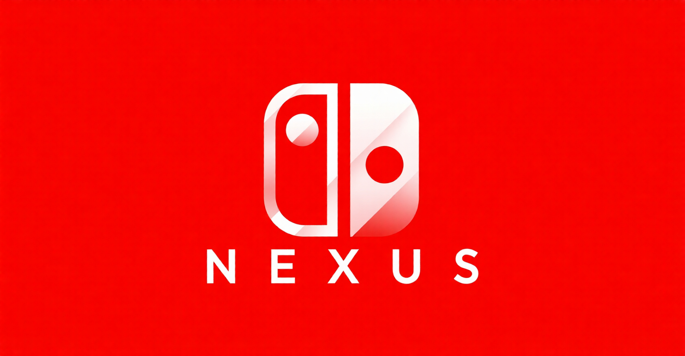

# NEXUS

**A console-style game library and integrated emulation environment for Windows.**

NEXUS is an independent, console-inspired gaming environment being developed for Windows. It brings your game library, user profiles, play statistics, controller navigation, themes and emulation settings together in one interface.

NEXUS is being developed around an integrated emulation engine. The intended experience is to launch and manage games from NEXUS itself, rather than asking users to choose and launch a separate emulator application.

## Download

**[⬇ Download the latest NEXUS for Windows (Releases)](https://github.com/0ryzin/Nexus/releases/latest)**

**Platform:** Windows 10 and 11, x64 (preview). NEXUS is released for Windows only.

Every release lists what it brings. Download `NEXUS-<version>-Windows-x64.zip`, extract the whole folder anywhere, and run `NEXUS\NEXUS.exe`. Nothing else needs installing. All versions: [Releases](https://github.com/0ryzin/Nexus/releases).

> **Development status:** NEXUS is a preview (0.x). The NEXUS Engine is built, tested and included in every release ZIP, and NEXUS loads it automatically. Running real games has **not** been tested by the project yet (the build machines have no GPU or games), so expect problems and please report them. See [Engine status](docs/ENGINE_STATUS.md).

## Project goals

- A console-like experience with a startup sequence and controller-friendly interface.
- One library for games, with search, sorting, artwork and per-game settings.
- Multiple user profiles, separate saves, play-time statistics and compatibility notes.
- Customisable themes, colours, wallpapers and startup options.
- An integrated engine that NEXUS controls directly, with engine builds verified before installation and the ability to roll back.
- A portable application folder, with user data stored separately by default where supported.

## Current features

- A startup animation, home screen and game library.
- User profiles, profile icons and per-user play statistics.
- Controller, keyboard and mouse navigation.
- Game artwork management, library search and sorting.
- Themes, wallpapers and appearance settings.
- Per-game settings and compatibility tracking.
- Engine management screens, including verified engine-build installation and rollback support.
- First-time setup (name, picture, profile colour), up to 8 users, separate saves per user.
- Light and dark themes throughout.
- Controller layouts for all games or per game (Nintendo or Xbox button positions, controller type, any button remapped).
- Frame generation (AMD FSR 3, or Lossless Scaling with your own copy), NVIDIA DLSS in place of a game's DLSS on RTX cards, AMD FSR 4 on Radeon RX 9000 — offered only when your graphics card supports them.
- Save Data: every user's saves in `UserData\Saves\<PLAYER_ID>-<name>\<GAME_ID>-<SHORT>` (for example `0400486024DEC000-OOT`), with easy import (player and game identified), export, backup, restore and delete — never without confirmation and a backup.
- Media tab: screenshots (Alt+F12 or the controller's capture button) and **screen recordings (F12)** with their game and date.
- Screen recording of the game window only, with the game's sound and optionally your microphone, using the graphics card's video encoder (NVIDIA NVENC, AMD, Intel Quick Sync) when present; settings for resolution, frame rate, quality, format and folder.
- Save import from Lichii's save folder (read only; NEXUS backs up before replacing anything).
- NEXUS Home with one press of the Home key or the controller's Home button; F11 for fullscreen/window while playing.
- Remembered controllers and a chosen controller per player.
- Game Updates and Mods per game, checked before they are accepted.
- Automatic NEXUS updates, verified by SHA-256, with automatic rollback.
- NEXUS manages its own system files; it never needs another emulator.
- A full-screen NEXUS loading screen with the game's artwork and real loading steps; the game window appears only once the game is drawing.
- **NEXUS Home while playing:** press the Home key (your choice, or off) or the controller's Home/Guide button to return to NEXUS. The game keeps running in the background, muted and receiving no input (or pauses, if you prefer); its tile shows a green dot, with *Resume* and *Close game*. If H is used by your game controls, NEXUS leaves it to the game and tells you.
- **Performance monitor:** an overlay at the top or bottom of the screen with FPS, frame time, CPU and GPU use and temperature, VRAM, RAM and RAM speed. Anything that can't be measured on your PC shows N/A. Choose metrics, opacity and size, for all games or chosen games, and toggle it while playing.
- **Frame rate and VSync:** a frame rate limit for Switch 2 games (30–240, presets 30/60/90/120/144/165/240) or "match my display's refresh rate", VSync on/off/mailbox, per game. Switch 1 games run at their own rate; turning off the emulation speed limit speeds the game up rather than adding frames; frame generation adds frames on top.

Real-game launching has not yet been validated by the project; see *Development status*.

## Emulation engine

The NEXUS emulation project draws on the work and codebases of **Lichii, Eden, yuzu and Ryujinx**, including related forks and components such as Ryubing. These projects have contributed to the wider foundation and development of NEXUS's emulation capabilities. Their original names, licences and notices remain acknowledged; see [Third-party notices and acknowledgements](THIRD_PARTY_NOTICES.md).

NEXUS is designed to load its emulation engine directly. It is not intended to launch a separate Lichii, Ryujinx or other emulator application when a game is selected.

The engine ships inside the release ZIP (`NEXUS\Engine`) and is built from upstream Lichii (currently build-160) plus the NEXUS patches in [`engine/patches`](engine/patches).

Switch 2 support is experimental upstream work and has **not** been verified by NEXUS. No Switch 2 compatibility claim is made.

More detail: [Engine architecture and status](docs/ENGINE_STATUS.md).

## Requirements

NEXUS releases are for:

- Windows 10 or Windows 11, 64-bit.
- Microsoft Edge WebView2 Runtime.
- (The Microsoft Visual C++ runtime the engine needs is included.)
- A graphics driver supporting Vulkan 1.3 (recommended) or OpenGL 4.6.
- Your own legally obtained game dumps, console keys and firmware. These are not included.

NEXUS does not provide games, console keys or firmware.

## Getting started

1. Download the latest ZIP from [Releases](https://github.com/0ryzin/Nexus/releases/latest).
2. Extract the whole ZIP (keep the folders together) and run `NEXUS\NEXUS.exe`.
3. Follow the first-time setup: name, picture, profile colour.
4. Put your games in `NEXUS\Games` or add your game folders in System Settings.
5. Install your own keys and firmware in *System Settings › System files*.

To update, download the new ZIP and replace the NEXUS folder; your users, saves and settings are kept in `%APPDATA%\NEXUS`.

## Data and portability

On the current Windows development build, NEXUS stores user data under:

    %APPDATA%\NEXUS\

This includes profiles, settings, artwork, statistics, logs, saves and engine data. The program and engine-build folders remain alongside NEXUS.exe.

An empty portable.txt beside NEXUS.exe enables portable mode, keeping application data inside the NEXUS folder.

## Versioning

Releases are numbered from **0.0.0** (preview). The first intended stable release is **1.0.0**. Each release on the [Releases](https://github.com/0ryzin/Nexus/releases) page has its notes; the history is in [CHANGELOG.md](CHANGELOG.md).

NEXUS application versions and NEXUS Engine build versions are tracked separately. See [VERSIONING.md](VERSIONING.md).

## Repository contents and source availability

- `app/` — the NEXUS application (Go + WebView2) and its release tooling.
- `engine/patches/` — the NEXUS engine as patches on upstream Lichii; `app/engine.lock` names the upstream base.
- `capture/` — the NEXUS screen-recording module (`nexus_capture.dll`, Windows APIs only).
- `docs/` — [architecture](docs/ARCHITECTURE.md), [source audit](docs/SOURCE_AUDIT.md), [performance](docs/PERFORMANCE.md), [publisher identity and signing](docs/SIGNING.md), [engine status](docs/ENGINE_STATUS.md), release notes.
- `.github/workflows/nexus-build.yml` — the Windows build: engine, tests, NEXUS.exe, the ZIP, and the release (when `docs/releases/v<version>.md` exists), with a check that the published download works.

Every release ZIP contains the corresponding source (`Source\`) and the licence notices. See [LICENSE](LICENSE) and [THIRD_PARTY_NOTICES.md](THIRD_PARTY_NOTICES.md).

## Licensing and acknowledgements

The NEXUS project and its GPL-licensed components are distributed under **GNU GPL version 3 or, at your option, any later version**, subject to the separate licences that apply to third-party components and assets. The full licence is in [LICENSE](LICENSE).

NEXUS draws on Lichii, Eden, yuzu and Ryujinx, including related forks and components such as Ryubing. Other bundled libraries, fonts and engine dependencies have their own licences and attribution requirements. See [THIRD_PARTY_NOTICES.md](THIRD_PARTY_NOTICES.md) for licensing information, notices and acknowledgements.

The profile icon pack (`Resources\ProfileIcons`) is Nintendo-derived artwork. It is not licensed by this repository; see its NOTICE file.

NEXUS is an independent project and is not affiliated with, endorsed by, or sponsored by Nintendo. Nintendo Switch is a trademark of Nintendo.

## Updates

NEXUS checks for new versions itself (*Settings › Updates*), verifies the download's SHA-256, installs it and rolls back if the new version does not start. Every version is also on the [Releases](https://github.com/0ryzin/Nexus/releases) page.

`NEXUS.exe` lists *Nexus Development* as its company in *Properties › Details*. That is the program's own description; NEXUS is not code-signed yet, so Windows SmartScreen may warn the first time. See [docs/SIGNING.md](docs/SIGNING.md).

## Disclaimer

NEXUS is experimental software supplied without warranty. Emulation compatibility, performance and stability vary by game, hardware, drivers and engine build. Use only game files and system files you are legally entitled to use.
